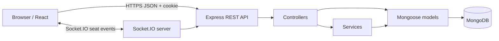

# IMovies — Movie Ticket Booking Made Simple

IMovies is a full-stack movie ticket booking application built with React, Vite, Node.js, Express, MongoDB, Mongoose, JWT cookies, and Socket.IO. It demonstrates movie discovery, showtime selection, live seat availability, a simulated checkout, booking history, cancellation rules, and administrator management tools.

> **Demo checkout only:** the application does not process real payments or charge money. Movie poster URLs are optional external assets; a fallback is shown when a poster cannot load.

## Highlights

- Cinematic, responsive React interface with search, genre/language filters, movie details, and showtimes.
- Registration/login with bcrypt password hashing, JWT in an HTTP-only cookie, protected routes, and `USER` / `ADMIN` roles.
- MongoDB models for users, movies, cinemas, showtimes/seat inventories, and bookings.
- Atomic, conditional MongoDB update to claim all selected seats in a single showtime document; concurrent requests cannot both claim the same available seat.
- Socket.IO broadcasts showtime seat-state changes to connected clients.
- Simulated checkout with a booking reference, booking history, a downloadable plain-text ticket summary, and cancellation window (at least two hours before showtime).
- Admin dashboard and movie/cinema/showtime/booking management.
- Structured errors, validation, rate limits for login/register, Helmet, CORS allowlist, `.env.example` files, and documentation.

## Tech stack

| Area | Technologies |
|---|---|
| Frontend | React, Vite, React Router, Axios, Bootstrap 5, Lucide React |
| Backend | Node.js, Express, Mongoose, Zod, bcryptjs, JWT, Socket.IO |
| Database | MongoDB local or MongoDB Atlas |
| Testing | Vitest, Supertest |

## Architecture



More detail: [`docs/ARCHITECTURE.md`](docs/ARCHITECTURE.md) · [`docs/ER_DIAGRAM.md`](docs/ER_DIAGRAM.md) · [`docs/USER_FLOW.md`](docs/USER_FLOW.md) · [`docs/API_DOCUMENTATION.md`](docs/API_DOCUMENTATION.md) · [`docs/DEPLOYMENT.md`](docs/DEPLOYMENT.md).

## Project structure

```text
imovies/
├── client/                 # React + Vite frontend
│   └── src/{components,context,pages,routes,services,utils}/
├── server/                 # Express API and Socket.IO server
│   ├── config/ controllers/ middleware/ models/ routes/
│   ├── services/ sockets/ scripts/ tests/
│   └── app.js server.js
├── docs/                   # Architecture, diagrams, report, test and demo instructions
├── .gitignore
└── package.json
```

## Prerequisites

- Node.js 20 or newer (Node.js 22 recommended).
- npm.
- MongoDB Community Server running locally, or a MongoDB Atlas database connection string.
- Git for source control.

## Local setup (Windows PowerShell)

1. Open a terminal in the repository root.
2. Install dependencies:

   ```powershell
   npm run install:all
   ```

3. Create the backend environment file:

   ```powershell
   Copy-Item server/.env.example server/.env
   ```

4. Edit `server/.env`. Set a long random `JWT_SECRET` (at least 32 characters), your MongoDB URI, the frontend origin, and a local demo-admin email/password. Never commit this file.

   ```dotenv
   PORT=5000
   NODE_ENV=development
   MONGODB_URI=mongodb://127.0.0.1:27017/imovies
   JWT_SECRET=replace_with_a_long_random_secret_at_least_32_characters
   JWT_EXPIRES_IN=1d
   CLIENT_URL=http://localhost:5173
   ADMIN_EMAIL=admin@example.com
   ADMIN_PASSWORD=change_this_local_demo_password
   ```

   The values shown are examples, not real credentials. If using Atlas, replace `MONGODB_URI` with the database connection string and ensure network access is configured.

5. (Optional) Create `client/.env` from `client/.env.example` if you need to change the API URL. Default local URLs work without it.
6. Seed demo data and create/update the local admin account:

   ```powershell
   npm run seed
   ```

   This inserts/upserts sample movies, two cinemas, upcoming showtimes and 48-seat inventories. Seed data can include future showtimes for five days. Running the script again will upsert catalogue items and skip duplicate showtime slots by their movie/cinema/start time. Configure `ADMIN_EMAIL` and `ADMIN_PASSWORD` in `server/.env` before running the seed command if you want an admin user.
7. Start the frontend and backend together:

   ```powershell
   npm run dev
   ```

8. Open **http://localhost:5173**. The API health endpoint is **http://localhost:5000/api/health**.

### Alternative: separate terminals

```powershell
npm --prefix server run dev
npm --prefix client run dev
```

## Example local workflow

1. Register a normal user using the app.
2. Browse a movie and open its details.
3. Choose a cinema and showtime.
4. Sign in if prompted, choose seats, review the total, and confirm the simulated checkout.
5. Visit **My bookings** to view the booking reference and cancellation eligibility.
6. Sign in with the locally configured admin account to open `/admin`, manage movies/cinemas/showtimes, or review bookings.

The admin login is the `ADMIN_EMAIL` and `ADMIN_PASSWORD` configured in your own `server/.env`. Do not publish real credentials in this README.

## Build and test

```powershell
npm run build
npm test
```

The API test suite includes health/404 smoke tests and booking-input validation tests without a database. Additional API and concurrency integration tests are available when `MONGODB_TEST_URI` points to an isolated test database; run them only against test data. See [`docs/TESTING.md`](docs/TESTING.md).

## API overview

- `GET /api/health`
- `/api/auth` — register, login, logout, current user
- `/api/movies` — listing, search, details; write operations are admin-only
- `/api/cinemas` — list; write operations are admin-only
- `/api/showtimes` — list, detail; write operations are admin-only
- `/api/bookings` — authenticated booking creation, history, detail, cancellation
- `/api/admin` — admin dashboard and booking administration

See [`docs/API_DOCUMENTATION.md`](docs/API_DOCUMENTATION.md) for request bodies, access controls, and response shapes.

## Security and known limitations

- Passwords are hashed with bcrypt. Authentication uses a JWT inside an HTTP-only cookie and is protected by server-side authorization checks.
- The server computes totals and validates seat availability; it does not trust the browser's selected prices.
- Seat claims use a single atomic conditional update to one showtime document. If the booking record creation throws, the code attempts a compensating seat release. For a production payment workflow, use replica-set transactions plus an idempotent payment/outbox design and recovery jobs.
- Checkout is simulated and refunds are just status labels; no payment provider is connected.
- The frontend does not include automated browser E2E coverage. Verify the booking workflow manually against a configured MongoDB before presenting it.
- Public sample poster links depend on their image hosts. An in-app fallback keeps failed images from breaking layout.
- Deployment requires separate frontend/backend origins, secure cookie settings, a production MongoDB URI, and an explicitly configured CORS origin.

## Screenshots and demo

Screenshots should be genuine captures of the running application. The folder [`docs/screenshots/`](docs/screenshots/) contains instructions/placeholders until screenshots can be captured using a browser. The recording plan is in [`docs/DEMO_SCRIPT.md`](docs/DEMO_SCRIPT.md).

- Live application: _add your deployed URL here after deployment_
- Demo video: _add your recorded video URL here_
- GitHub repository: _add your repository URL here_

## GitHub upload

Review `.gitignore`, ensure there are no `.env` files or credentials staged, then run these commands from the project root after creating an empty GitHub repository:

```bash
git init
git add .
git status --short
git commit -m "Initial commit: IMovies movie ticket booking application"
git branch -M main
git remote add origin YOUR_GITHUB_REPOSITORY_URL
git push -u origin main
```

Replace `YOUR_GITHUB_REPOSITORY_URL` with the actual URL of your repository. Do not commit `node_modules`, `.env`, logs, or private database credentials.

## Author

- Name: _add your preferred author name_
- GitHub: _add your GitHub profile URL_
- LinkedIn: _add your LinkedIn profile URL_

## Future improvements

- Add optional real payment integration behind server-side webhook verification.
- Add formal distributed reservation holds with expiration and recovery.
- Add QR-code tickets and email notifications.
- Add browser-based end-to-end tests and CI.
- Add accessibility audit and localisation.
