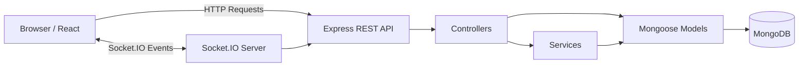

# 🎬 iMovies — Movie Ticket Booking Application

**Discover movies. Choose your showtime. Book your seats.**

iMovies is a full-stack movie ticket booking web application built using React, Vite, Node.js, Express, MongoDB, and Socket.IO. It provides a cinematic movie discovery experience with user authentication, cinema showtimes, interactive seat selection, booking management, and administrator tools.

The application integrates with **The Movie Database (TMDB) API** to import movie information and uses MongoDB to manage movies, cinemas, showtimes, seats, and bookings.

> **Note:** Checkout is simulated for demonstration purposes. No real payments are processed or money charged.

## ✨ Features

- **Movie Discovery:** Browse movies with search, genre filters, language filters, ratings, and movie details.
- **TMDB Integration:** Import movie information from TMDB.
- **Authentication:** User registration and login using bcrypt password hashing and JWT authentication stored in HTTP-only cookies.
- **Role-Based Access:** Separate `USER` and `ADMIN` permissions.
- **Cinema & Showtimes:** Browse cinemas and available showtimes.
- **Interactive Seat Selection:** View seat availability and select seats for booking.
- **Real-Time Updates:** Socket.IO broadcasts seat-state changes to connected clients.
- **Booking Management:** Create bookings, view booking history, and cancel eligible bookings.
- **Simulated Checkout:** Complete a demo booking and receive a booking reference.
- **Admin Dashboard:** Manage movies, cinemas, showtimes, and bookings.
- **Security:** Request validation, rate limiting, Helmet, CORS configuration, and structured error handling.

## 🛠️ Tech Stack

| Area                    | Technologies                                                |
| ----------------------- | ----------------------------------------------------------- |
| Frontend                | React, Vite, React Router, Axios, Bootstrap 5, Lucide React |
| Backend                 | Node.js, Express.js, Mongoose, Zod                          |
| Authentication          | JWT, bcryptjs, HTTP-only cookies                            |
| Database                | MongoDB                                                     |
| Real-time communication | Socket.IO                                                   |
| Testing                 | Vitest, Supertest                                           |
| External API            | TMDB API                                                    |

## 🏗️ Architecture



For more details, see:

- [Architecture](docs/ARCHITECTURE.md)
- [ER Diagram](docs/ER_DIAGRAM.md)
- [User Flow](docs/USER_FLOW.md)
- [API Documentation](docs/API_DOCUMENTATION.md)
- [Deployment Guide](docs/DEPLOYMENT.md)

## 📁 Project Structure

```text
imovies/
├── client/                  # React + Vite frontend
│   └── src/
│       ├── components/
│       ├── context/
│       ├── pages/
│       └── services/
│
├── server/                  # Express backend
│   ├── config/
│   ├── controllers/
│   ├── middleware/
│   ├── models/
│   ├── routes/
│   ├── scripts/
│   ├── services/
│   ├── sockets/
│   └── tests/
│
├── docs/                    # Project documentation
├── .gitignore
├── package.json
└── README.md
```

## ⚙️ Getting Started

### Prerequisites

Install the following before running the project:

- Node.js 20 or newer (Node.js 22 recommended)
- npm
- MongoDB Community Server or MongoDB Atlas
- Git
- A TMDB API Read Access Token for importing movie data

### 1. Clone the repository

```bash
git clone https://github.com/Aman-Saxena-09/imovies.git
cd imovies
```

### 2. Install dependencies

```bash
npm run install:all
```

### 3. Configure environment variables

Create the backend environment file:

**Windows PowerShell:**

```powershell
Copy-Item server/.env.example server/.env
```

Open `server/.env` and configure your local settings:

```env
PORT=5000
NODE_ENV=development
MONGODB_URI=mongodb://127.0.0.1:27017/imovies

JWT_SECRET=replace_with_a_random_secret_of_at_least_32_characters
JWT_EXPIRES_IN=1d

CLIENT_URL=http://localhost:5173
COOKIE_SAME_SITE=lax

ADMIN_EMAIL=admin@example.com
ADMIN_PASSWORD=change_this_local_demo_password

TMDB_API_KEY=your_tmdb_api_key
TMDB_ACCESS_TOKEN=your_tmdb_read_access_token
```

Use your own credentials. Never commit your actual `.env` file or expose API tokens and passwords publicly.

An optional frontend environment file can be created from `client/.env.example` if you need to customize the API URL.

### 4. Seed initial demo data

```bash
npm run seed
```

This creates sample movies, cinemas, showtimes, and seat inventories.

Configure `ADMIN_EMAIL` and `ADMIN_PASSWORD` in `server/.env` before running the seed command if you want to create the local administrator account.

### 5. Import movies from TMDB

After configuring your TMDB credentials, run:

```bash
npm --prefix server run import:tmdb
```

This imports movie information from TMDB into your MongoDB database.

### 6. Generate demo showtimes

To generate demo showtimes for eligible imported movies:

```bash
npm --prefix server run generate:showtimes
```

These are demonstration schedules, not real cinema schedules.

### 7. Start the application

```bash
npm run dev
```

Open the application:

**Frontend:** [http://localhost:5173](http://localhost:5173)

**Backend health check:** [http://localhost:5000/api/health](http://localhost:5000/api/health)

Alternatively, start the frontend and backend separately:

```bash
npm --prefix server run dev
```

```bash
npm --prefix client run dev
```

## 🎟️ How to Use

1. Register a new user account or log in.
2. Explore the movie collection.
3. Search for a movie and open its details.
4. Choose an available cinema and showtime.
5. Select your preferred seats.
6. Review the booking details and confirm the simulated checkout.
7. Visit **My Bookings** to view your booking reference and booking history.
8. Administrators can access the admin dashboard to manage application data.

## 🔌 API Overview

| Endpoint          | Description                                         |
| ----------------- | --------------------------------------------------- |
| `GET /api/health` | API health check                                    |
| `/api/auth`       | Registration, login, logout, current user           |
| `/api/movies`     | Movie listing, search, details and administration   |
| `/api/cinemas`    | Cinema listing and administration                   |
| `/api/showtimes`  | Showtime listing and administration                 |
| `/api/bookings`   | Booking creation, history, details and cancellation |
| `/api/admin`      | Admin dashboard and booking administration          |

For request formats, authentication requirements, and response examples, see [API Documentation](docs/API_DOCUMENTATION.md).

## 🧪 Build and Testing

Build the application:

```bash
npm run build
```

Run tests:

```bash
npm test
```

The project includes API health checks, booking validation tests, and additional database-backed integration and concurrency tests.

For test setup and details, see [Testing Documentation](docs/TESTING.md).

## 🔐 Security and Limitations

- Passwords are hashed using bcrypt.
- Authentication uses JWT tokens stored in HTTP-only cookies.
- Role-based middleware protects administrator routes.
- The backend validates seat availability and calculates booking totals.
- Seat reservation uses conditional MongoDB updates to prevent conflicting seat claims.
- Socket.IO provides real-time seat-state notifications.
- Checkout is simulated; no real payment provider is connected.
- Production payment integration would require secure payment verification, webhook handling, and appropriate transaction/recovery mechanisms.
- Demo movie schedules should not be treated as actual cinema availability.
- Production deployment requires secure environment variables, HTTPS, appropriate cookie settings, and a configured CORS allowlist.

## 📸 Screenshots and Demo

Screenshots and a demo video can be added here as the project develops.

- **Live Application:** Coming soon
- **Demo Video:** Coming soon
- **GitHub Repository:** [https://github.com/Aman-Saxena-09/imovies](https://github.com/Aman-Saxena-09/imovies)

## 👨‍💻 Author

**Aman Saxena**

- GitHub: [@Aman-Saxena-09](https://github.com/Aman-Saxena-09)

## 🚀 Future Improvements

- Integrate a real payment gateway with server-side payment verification.
- Add QR-code-based tickets.
- Add email notifications for booking confirmation and cancellation.
- Implement expiring seat reservation holds.
- Add automated browser-based end-to-end tests.
- Improve accessibility and localization.
- Deploy the application with a production database and secure infrastructure.

---

*Movie information and images are provided through TMDB. This project is not endorsed or certified by TMDB.*
