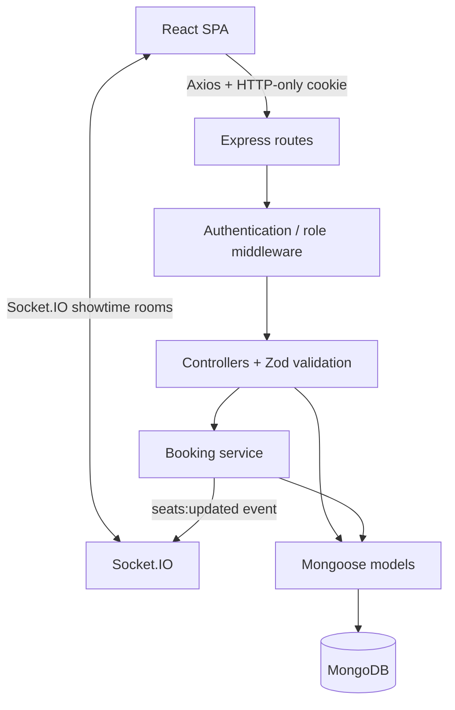

# IMovies Technical Architecture

## Overview

IMovies uses a client-server design. The React/Vite client owns routing, forms, seat selection visuals and booking summaries. The Express API authenticates requests, validates payloads, derives seat prices from MongoDB, and implements booking rules. Mongoose maps application models to MongoDB documents. Socket.IO pushes public seat-status changes to clients that join the corresponding showtime room.

## Component responsibilities

- `client/src/pages/`: page-level views, loading states and route-specific user interaction.
- `client/src/components/`: reusable navigation, movie cards, poster fallback, protected route and spinner.
- `client/src/context/`: authentication and user-facing toast state.
- `client/src/services/api.js`: one Axios client with cookie support and shared API errors.
- `server/routes/`: URL-to-controller mapping and route-level auth requirements.
- `server/controllers/`: HTTP orchestration and responses.
- `server/models/`: validated Mongoose data definitions and indexes.
- `server/services/booking.service.js`: critical seat claim / booking / cancellation flow.
- `server/middleware/`: authentication, admin role guard, validation and error normalisation.
- `server/sockets/`: joins clients to showtime rooms and broadcasts no private user data.
- `server/scripts/seed.js`: idempotent-ish upserts for demo movies, cinemas, showtimes, seat inventory and a configured local admin account.

## Authentication

Registration hashes a password with bcrypt before storing it. Login verifies the hash and signs a JWT. The token is set in the HTTP-only `imovies_token` cookie. The browser cannot read this cookie with JavaScript; Axios sends it because `withCredentials: true` is enabled. Middleware verifies the JWT, reloads the user, and admin routes also check the user's persisted role. In production, use HTTPS so the cookie can be `Secure`.

## Booking consistency strategy

Each show's seat inventory is stored inside its `Showtime` MongoDB document. Booking first reads current seat prices and validates input. It then issues a **single conditional update** on that showtime document: the update succeeds only if every requested seat exists and none is already marked booked. The update pipeline marks all selected seats `BOOKED` with the new booking ObjectId. MongoDB performs a single-document write atomically, so two concurrent requests for the same seats cannot both pass the same precondition. The server creates a booking document after the claim; if that write fails, it attempts to release seats still tagged with that booking ID.

This avoids requiring replica-set transactions for the basic local demo and is a reasonable demonstration for a single-showtime inventory. The compensating update is best-effort, not a substitute for a durable distributed transaction. A production system should use a replica set, multi-document transactions, reservation holds with expiry, an idempotent booking/payment workflow, durable events, and reconciliation of stale seat claims.

Cancellation uses a conditional booking state transition and then releases only seats whose `bookingId` matches the booking. The user cancellation endpoint applies a two-hour cutoff. Admin cancellations reject past screenings. The simulated payment status changes to `REFUNDED_DEMO`; no real refund takes place.

## Real-time updates

When a booking succeeds or its seats are released, the API emits `seats:updated` into `showtime:<id>`. The payload contains seat number, availability, type, and price only. Clients subscribe to their current showtime and update the visual seat map. Socket messages are a user-interface hint: the REST booking endpoint remains authoritative and revalidates availability.

## Environment configuration

The backend reads `server/.env`. The frontend reads only public Vite variables from `client/.env` (prefix `VITE_`). Do not put JWT secrets, database URIs, or admin passwords in any `VITE_` variable. Configure `CLIENT_URL` to the exact frontend origin(s); do not use wildcard origins with credentials.
