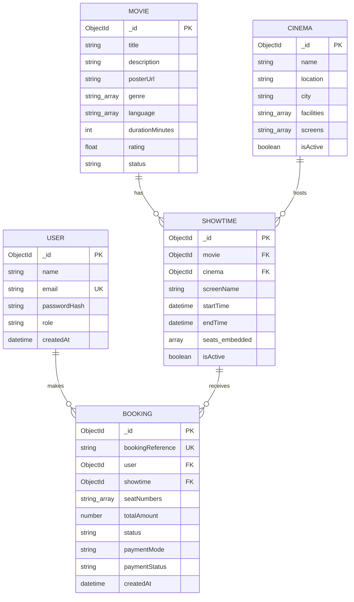

# IMovies ER Diagram

The diagram represents the current Mongoose model relationships. Seat inventory is embedded inside each `Showtime` because a seat's availability is scoped to a specific screening. A booking also stores selected seat numbers and a small display snapshot of movie/cinema details to preserve the confirmation screen if catalogue data changes later.

## Relationship notes

- A `User` can create multiple `Booking` documents.
- A `Movie` can have multiple `Showtime` documents.
- A `Cinema` hosts multiple `Showtime` documents.
- Each `Showtime` embeds a unique seat inventory for that screening and can have multiple bookings over time, including cancelled bookings.
- `Booking.seatNumbers` stores the seats in that reservation; the live seat status is tracked on the showtime document.
- `passwordHash` is excluded from normal user serialisation and selected explicitly only when validating a login.
