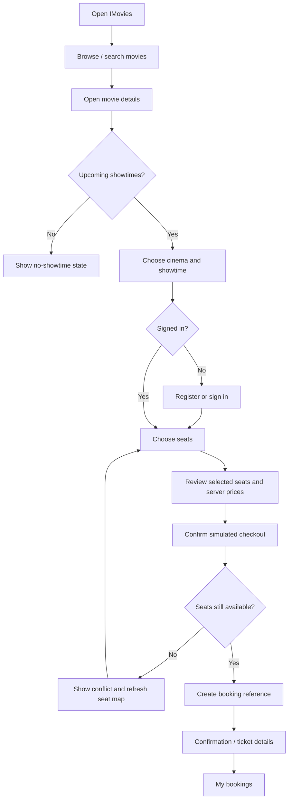

# IMovies User Flow

## Customer booking journey

## Error and recovery scenarios

- **Registration or login failure:** the page shows the API message and preserves the form so the user can correct input.
- **Expired / invalid session:** a protected API returns `401`; protected frontend routes send signed-out users to login.
- **Seat taken by another user:** Socket.IO updates the seat map when connected; booking submission performs a final atomic server-side availability check and returns a `409` if the seats were claimed first.
- **Booking record creation failure:** the booking service attempts a compensating update to release seats tagged by that reservation ID.
- **Cancellation too close to screening:** customer cancellations are rejected less than two hours before showtime. The user sees an error message.
- **Cancellation success:** the booking transitions from `CONFIRMED` to `CANCELLED`, demo payment status is set to `REFUNDED_DEMO`, and seats associated with that booking ID are released.
- **API/database unavailable:** loading ends in an error state; the README documents database setup and the `/api/health` endpoint can test the API process separately from database connectivity.

## Administrator workflow

1. Configure `ADMIN_EMAIL` and `ADMIN_PASSWORD` locally in `server/.env`.
2. Run `npm run seed` to create/update the local administrator user.
3. Sign in and open `/admin`.
4. Use the management pages to create movies, cinemas and future showtimes. Creating a showtime creates a 48-seat sample layout if no custom layout is supplied.
5. Review bookings at `/admin/bookings`. The API checks the authenticated user's stored role, not a frontend-only flag.
